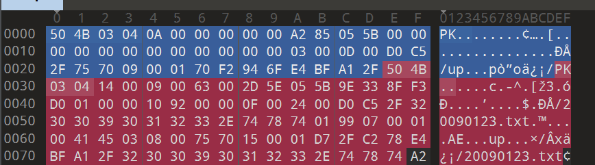
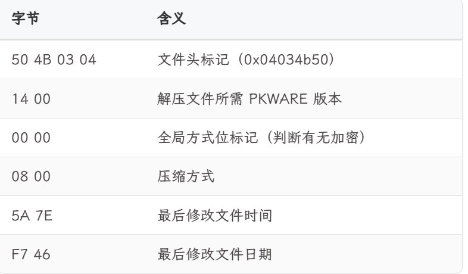

# ZIP文件处理建议

在做CTF的misc题目时经常会碰到需要密码的zip文件，打开这种需要密码的方法无非就这三种：

​       （1）根据提示或其他文件解出密码

​       （2）暴力破解

​       （3）伪加密修改

## 一、ZIP 文件结构中的三个关键区域

### 1. 压缩源文件数据区

### 2. 压缩源文件目录区（中央目录文件头）

### 3. 压缩源文件目录结束标志（中央目录结尾）