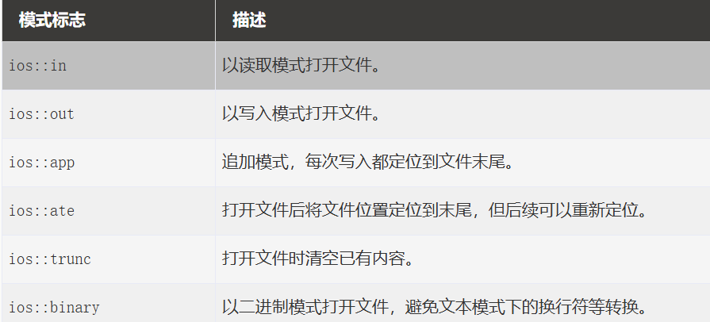

#  C++数据保存与管理办法

[C++数据保存方法-CSDN博客](https://blog.csdn.net/wangxun20081008/article/details/115033507)


## 一，freopen

```c
FILE *__cdecl freopen(
	const char * __restrict__ _Filename,
	const char * __restrict__ _Mode,
	FILE * __restrict__ _File
)

```

```c
#include <bits/stdc++.h>
using namespace std;

int a;

int main() {
	freopen("text.txt","w",stdout);     //打开text.txt,并设置为输出
	cin>>a;
	cout<<a<<endl;                      //将a输出到text.txt
	fclose(stdout);                     //关闭文件
    return 0;
}
```

## 二，ifstream和ofstream

> 支持数据类型
>
> ```
> 1常见
> bool
> short, unsigned short
> int, unsigned int
> long, unsigned long
> long long, unsigned long long
> float, double, long double
> char, signed char, unsigned char
> char*（C风格字符串数组，注意越界风险）
> void*
> std::string s;
> fr >> s;
> 2自定义类？？
> class A { ... };
> istream& operator>>(istream& is, A& obj) {
>     // 读入成员
>     return is;
> }
> 
> 
> ```

## outfile & infile


## 文件打开模式




```c++
#include <fstream>
#include <iostream>
using namespace std;

//fstream方法
ofstream outfiled("exist?.txt")	//尝试打开 如果不存在则创建
ifstream outfiled("text.txt")//默认ios::in
fstream outfiled("text.txt") //ios::in | ios::out
    
//open方法
ofstream outfile;

outfile.open("example.txt");	//默认是ios::out
		//多个模式可以使用按位或运算符 | 组合。
outfile.open("example.txt" , std::ios::mode | ……)
outfile.open("file.txt" , ios::out | ios::trunc) //覆写
    
ofstream outfile;
outfile.open("example.txt" , ios::app)	// app == append 添加


```

## 检查文件是否打开

```c
int main(){
	ifstream infile("example.txt");
	
	if ( !infile.is_open()){
		/*
		失败处理
		*/
		}
	/*
	code...
	*/
	}
}
```

## 关闭文件

```c
outfile.close();
```

关闭文件时，文件流会尝试完成必要的缓冲区刷新，并解除与文件的关联。

C++ 文件流对象还具有自动资源管理机制。当局部文件流对象离开作用域并被销毁时，关联的文件也会自动关闭。

```c
{
    std::ofstream file("example.txt");
    file &lt;&lt; "Hello C++";
} // file 离开作用域，自动关闭文件
```

## 文件写入

```c
#include <iostream>
#include <fstream>
using namespace std;
 
int main()
{
    // 创建并打开文件
    ofstream outfile("example.txt");
 
    if (!outfile) {
        cerr << "无法打开文件！" << endl;
        return 1;
    }
 
    // 向文件写入内容
    outfile << "Hello C++" << '\n';
    outfile << "欢迎学习 C++ 文件操作" << '\n';
    outfile << "数字：" << 100 << '\n';
 
    // 关闭文件
    outfile.close();
 
    if (!outfile) {
        cerr << "文件写入或关闭失败！" << endl;
        return 1;
    }
 
    cout << "文件写入成功！" << endl;
 
    return 0;
}
```

## cerr输出

- 专门输出**错误、警告信息**
- **默认不缓冲：内容立刻输出，崩溃前也能打印出来**
- 控制台里很多终端会把 cerr 标成红色
- 可以和标准输出分开重定向：正常信息存文件，错误留在控制台

## 追加写入文件

```c
#include <iostream>
#include <fstream>
using namespace std;
 
int main()
{
    // 以追加模式打开文件
    ofstream outfile("example.txt", ios::app);
 
    if (!outfile) {
        cerr << "无法打开文件！" << endl;
        return 1;
    }
 
    outfile << "这是一行追加的内容。" << '\n';
 
    outfile.close();
 
    if (!outfile) {
        cerr << "文件写入失败！" << endl;
        return 1;
    }
 
    cout << "内容追加成功！" << endl;
 
    return 0;
}

//OS：件打开成功 ≠ 后面写入一定成功！
```

打开文件只是拿到文件句柄，后续写的时候依然会出错：

- 磁盘满了，写不进去
- 权限中途被收回
- 磁盘 IO 错误
- 写入的数据异常，触发流的**失败标记（failbit /badbit）**
- close () 本身也可能失败

## 文件读写

**getline逐行读取**

```c
#include <iostream>
#include <fstream>
#include <string>
using namespace std;
 
int main()
{
    ifstream infile("example.txt");
 
    if (!infile) {
        cerr << "无法打开文件！" << endl;
        return 1;
    }
 
    string line;
 
    // 逐行读取，直到文件结束或读取失败
    while (getline(infile, line)) {
        cout << line << endl;
    }
 
    if (infile.bad()) {
        cerr << "读取文件时发生错误！" << endl;
        return 1;
    }
 
    infile.close();
 
    return 0;
}
```

## 