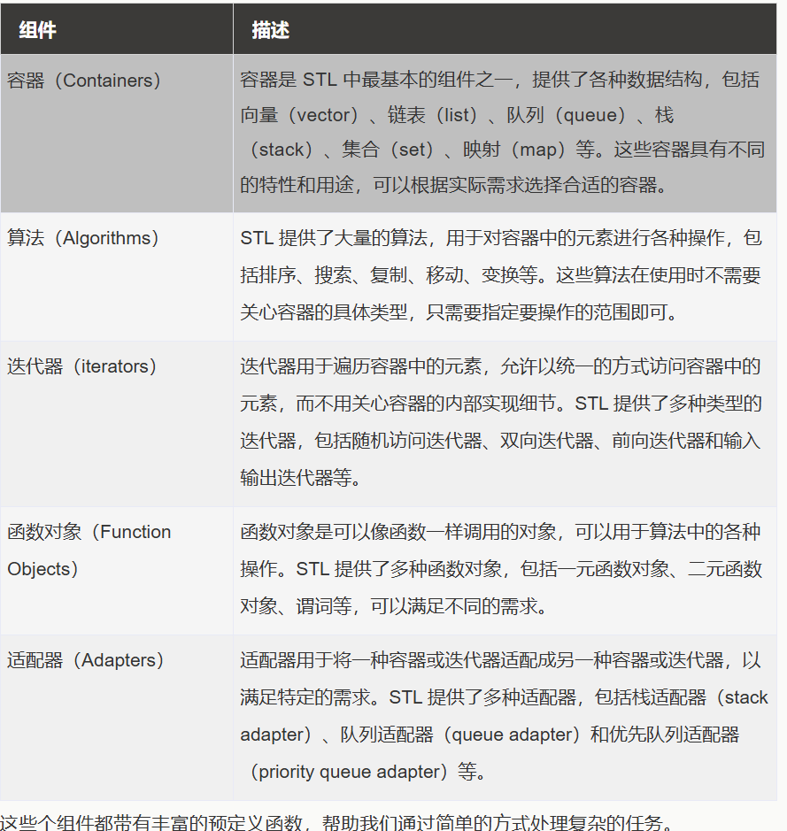
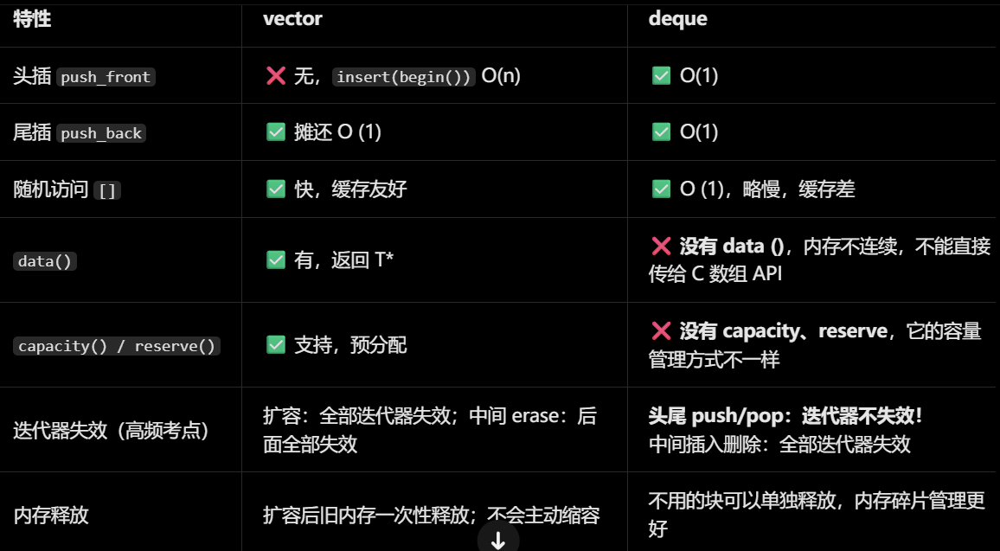

# C++ STL



## O，前置姿势

## i,.front .back() 和 .begin .end 有什么区别 

| 特性                | front() / back()             | begin() / end()            |
| ------------------- | ---------------------------- | -------------------------- |
| 返回                | 元素引用 T&                  | 迭代器 iterator            |
| 是否需要解引用      | ❌ 不需要，直接就是元素       | ✅ *it 才是元素             |
| end () 指向有效元素 | back () 指向最后一个有效元素 | end () 尾后，无效          |
| 能否 ++ --          | ❌ 不行，不是迭代器           | ✅ 可以移动                 |
| 用于 STL 算法       | ❌ 不能传进 sort/unique       | ✅ STL 算法的标准入参       |
| 空容器调用          | ❌ UB                         | ✅ 合法，两者相等           |
| 典型用法            | 取首尾值、修改首尾           | 遍历、区间操作、二分、排序 |

## ii，迭代器

迭代器是 STL 的核心抽象，作用是**用统一的方式遍历所有容器**，不用关心容器底层是数组、链表还是红黑树。

### 1. 获取迭代器

表格

| 函数                   | 含义                                                         |
| ---------------------- | ------------------------------------------------------------ |
| `.begin()`             | 指向第一个有效元素的迭代器                                   |
| `.end()                | 指向「最后一个元素之后」的尾后迭代器，不指向有效元素，不能解引用 |
| `.rbegin()` / `.rend() | 反向迭代器，从尾到头遍历                                     |

### 2. 移动迭代器

迭代器按能力从弱到强分为 5 类，竞赛最常用两类：

- **双向迭代器**（map、set、list）：只支持 `++it` 前进、`--it` 后退，不支持 `it + 3`、`it < end()`
- **随机访问迭代器**（vector、string、deque）：支持所有指针操作：`++`、`--`、`it + n`、`it - n`、`it1 < it2`、两迭代器相减求距离

```c
// vector（随机访问迭代器）
vector<int> v = {1,2,3,4,5};
auto it_v = v.begin();
it_v += 2;   // ✅ 直接跳2步
cout << it_v - v.begin(); // ✅ 求下标，输出2

// map（双向迭代器）
map<int,int> mp;
auto it_m = mp.begin();
++it_m;      // ✅ 只能一步步走
// it_m += 2; // ❌ 编译报错！不支持跳跃
// if (it_m < mp.end()) {} // ❌ 编译报错！只能用 == / !=
```

### 3. 遍历的标准写法

所有容器通用的迭代器遍历模板：

```c
for (auto it = 容器.begin(); it != 容器.end(); ++it) {
    // *it 访问元素，it->成员 访问元素内部成员
}
```

> 注意：统一用 `!=` 判断结束，不要用 `<`，双向迭代器不支持大小比较。

## iii.`->` 运算符：指针 / 迭代器的语法糖

### 1. `.` 运算符：对象直接访问自身成员

当变量本身就是一个结构体 / 类 /pair 对象时，用 `.` 直接访问它的内部成员。

- `p.first`：p 本身是 pair，`first` 是它的第一个成员

### 2. `->` 运算符：指针 / 迭代器的语法糖

`it->first` 是 `(*it).first` 的简写，执行两步：

1. 先对迭代器解引用 `*it`，拿到它指向的**元素本身（pair）**
2. 再用 `.` 访问这个元素的 `first` 成员

> 补充：不是所有迭代器都需要用 `->` 如果元素是基础类型（比如 `vector<int>`），直接解引用拿值即可，不需要 `->`：
>
> ```c++
> vector<int> v = {1,2,3};
> auto it = v.begin();
> cout << *it; // 直接拿到int值，没有成员可访问
> ```

## IV迭代器 vs 指针

### 1. 核心联系：指针是一种特殊的迭代器

- 原生指针完全满足「随机访问迭代器」的所有要求，可以直接当迭代器用

- 这也是为什么数组可以直接传入 STL 算法： 

  ```c
  int arr[] = {3,1,2};
  sort(arr, arr + 3); // arr 和 arr+3 是指针，当作迭代器传入sort
  ```

- vector、string 的迭代器在多数编译器实现中，底层本质就是封装过的指针

### 2. 核心区别

表格

| 维度     | 原生指针                         | 迭代器                                                    |
| -------- | -------------------------------- | --------------------------------------------------------- |
| 本质     | C/C++ 原生类型，存储内存地址     | 类模板对象，封装了 “指向元素” 的逻辑                      |
| 适用范围 | 只能操作连续内存（数组、vector） | 适配所有 STL 容器：链表、红黑树、哈希表等任意结构         |
| 操作能力 | 固定为随机访问，支持所有算术运算 | 分多个等级，能力随容器类型变化                            |
| 安全性   | 野指针、越界直接崩溃，无检查     | Debug 模式下多数 STL 实现会做越界、失效检查               |
| 语义     | 直接对应硬件内存地址             | 抽象的 “位置标记”，底层不一定是内存地址（如哈希表迭代器） |

### 3. 一句话总结

指针是迭代器的子集；迭代器是对 “指针语义” 的泛化，让所有容器都能用 “指针式” 的方式统一访问。

# I  . 容器_>

容器是用来存储数据的序列，它们提供了不同的存储方式和访问模式。

STL 中的容器可以分为三类：

1、序列容器：存储元素的序列，允许双向遍历。

- std::vector：动态数组，支持快速随机访问。
- std::deque：双端队列，支持快速插入和删除。
- std::list：链表，支持快速插入和删除，但不支持随机访问。

2、关联容器：存储键值对，每个元素都有一个键（key）和一个值（value），并且通过键来组织元素。

- std::set：集合，不允许重复元素。
- std::multiset：多重集合，允许多个元素具有相同的键。
- std::map：映射，每个键映射到一个值。
- std::multimap：多重映射，存储了键值对（pair），其中键是唯一的，但值可以重复，允许一个键映射到多个值。

3、无序容器（C++11 引入）：哈希表，支持快速的查找、插入和删除。

- std::unordered_set：无序集合。
- std::unordered_multiset：无序多重集合。
- std::unordered_map：无序映射。
- std::unordered_multimap：无序多重映射。

## 1.有序容器

1.1前置

emplace_back()原地构造：

```c++
#include <iostream>
#include <vector>
#include <string>
using namespace std;

struct Stu {
    string name;
    int age;
    Stu(string n, int a) : name(move(n)), age(a) {
        cout << "【构造】 " << name << "\n";
    }
    Stu(const Stu& other) : name(other.name), age(other.age) {
        cout << "【拷贝构造】 " << name << "\n";
    }
    Stu(Stu&& other) noexcept : name(move(other.name)), age(other.age) {
        cout << "【移动构造】 " << name << "\n";
    }
};

int main() {
    vector<Stu> v1, v2;
    cout << "===== emplace_back 版本 =====" << endl;
    v1.emplace_back("Alice", 18);
    cout << "\n===== push_back 版本 =====" << endl;
    v2.push_back(Stu("Bob", 20));

    cout << "\n===== 开始打印容器里的元素 =====" << endl;
    // 读取打印，这里完全没有区别！
    for(auto &s : v1) {
        cout << "v1: " << s.name << " " << s.age << "\n";
    }
    for(auto &s : v2) {
        cout << "v2: " << s.name << " " << s.age << "\n";
    }
    return 0;
}

===== 开始打印容器里的元素 =====
v1: Alice 18
v2: Bob 20
PS C:\Users\wangq\Desktop\ICPC-01> 
//值得注意的是：这个操作省略了中间右值的构造、
//从而节省了了开销
```

**1.1初始化**

```c++
vector<int> v1;
vector<int> v2(10);
vector<int> v3(10,5);
vector<int> v4 = {1, 2, 3};
vector<int> v5(v4.begin() , v4.end());
vector<int> v6(v4)；		//拷贝构造
vecotr<int> v7(move(v6)) //移动构造
```

**1.2迭代器**

```c
v.begin();  v.end();          // 首元素 / 尾后
v.rbegin(); v.rend();         // 反向迭代器（list 同样支持）
v.cbegin(); v.cend();         // const 版本
// list 没有随机访问迭代器，只支持双向迭代器（++/--）
// vector、deque 支持随机访问（it + n、it[n]、it1 - it2）
```

容量

```c++
v.size();        // 元素个数
v.empty();       // 是否为空（比 size()==0 更优）
v.capacity();    // vector 容量（deque/list 无此接口）
v.max_size();    // 理论最大元素数
v.reserve(100);  // 预留容量，避免重复扩容（仅 vector/deque）
v.resize(20);    // 调整大小（新元素值初始化）
v.resize(20, 0); // 调整大小并指定新元素值
v.shrink_to_fit(); // 释放多余容量（C++11，仅 vector）
```

元素访问

```c
v[0];           // 越界不检查（vector/deque 支持，list 不支持）
v.at(0);        // 越界抛 out_of_range（vector/deque 支持）
v.front();      // 首元素引用 —— 三个容器都支持
v.back();       // 尾元素引用 —— 三个容器都支持
// list 只能通过 front/back 和迭代器访问，没有 [] 和 at

```

修改操作（通用）

```c++
v.push_back(x);        // 尾插
v.emplace_back(args);  // 尾插，原地构造，更高效
v.pop_back();          // 删尾
v.insert(it, x);              // 在 it 前插入，返回新元素迭代器
v.insert(it, n, x);           // 插入 n 个 x
v.insert(it, first, last);    // 插入区间
v.emplace(it, args);          // 在 it 前原地构造
v.erase(it);           // 删 it 处元素，返回下一个迭代器
v.erase(first, last);  // 删区间
v.clear();             // 清空
v.swap(v2);            // 交换（O(1)）

//deque/list 特有 -- 头插/删
d.push_front(x);
d.pop_front(x);
d.emplace_front(args)
```

list特有

```c++
l.splice(it, l2);                // 把 l2 全部移动到 it 前（O(1)，不拷贝元素）
l.splice(it, l2, it2);           // 移动 l2 中 it2 指向的单个元素
l.splice(it, l2, first, last);   // 移动 l2 的一个区间
l.sort();                        // list 自带 sort（算法库的 sort 需要随机访问迭代器）
l.sort(greater<int>());          // 降序
l.merge(l2);                     // 归并两个有序 list，l2 变空
l.unique();                      // 去重（相邻重复，通常先 sort）
l.reverse();                     // 逆序
l.remove(x);                     // 删除所有等于 x 的元素
l.remove_if(pred);               // 条件删除
```

遍历

```c
for (int x : v) { /* ... */ }                    // 范围 for
for (auto it = v.begin(); it != v.end(); ++it);  // 迭代器
// 删除时的安全写法： ???
for (auto it = l.begin(); it != l.end(); ) {
    if (conditon) it = l.erase(it);   // erase 返回下一个迭代器
    else ++it;
}
//C++20推荐另一种写法
l.remove_if([](auto& x){ return condition}) // list写法
v.erase(std::remove_if(v.begin, v.end(), cond) v.end())

```

配合 <algorithm> 常用算法

```c++
sort(v.begin(), v.end());              // 排序（不能用于 list）
sort(v.rbegin(), v.rend());            // 降序
find(v.begin(), v.end(), x);           // 查找，返回迭代器
count(v.begin(), v.end(), x);          // 计数
reverse(v.begin(), v.end());           // 逆序（list 用自带 reverse）
min_element / max_element(v.begin(), v.end());
binary_search(v.begin(), v.end(), x);  // 要求已排序
```



## 2，关联容器/无序容器

> #include <set>  --multi
> #include <map>  --multi
>
> #include <unordered_set>
> #include <unordered_map>

```c++
std::set<int> s;                          // 有序集合，键唯一
std::multiset<int> ms;                    // 有序集合，键可重复

std::map<std::string, int> m;             // 有序映射，键唯一
std::multimap<std::string, int> mm;       // 有序映射，键可重复
//无序
std::unordered_set<int> us;               // 哈希集合
std::unordered_map<std::string, int> um;  // 哈希映射

//set定义
set<int> s1 = {3, 1, 2};                   // {1, 2, 3}，自动去重排序
set<int> s2(s1.begin(), s1.end());                // 区间构造
set<int, greater<int>> s3;                        // 自定义排序：降序
//map定义
map<string, int> m1 = {{"a", 1}, {"b", 2}};       // 初始化列表
map<string, int> m2(m1);                          // 拷贝构造

```

## MAP

在 C++ 中，`<map>` 是标准模板库（STL）的一部分，它提供了一种关联容器，用于存储键值对（key-value pairs）。

`map` 容器中的元素是按照键的顺序自动排序的，这使得它非常适合需要快速查找和有序数据的场景。

### 定义和特性

- **键值对**：`map` 存储的是键值对，其中每个键都是唯一的。
- **排序**：`map` 中的元素按照键的顺序自动排序，通常是升序。
- **唯一性**：每个键在 `map` 中只能出现一次。
- **双向迭代器**：`map` 提供了双向迭代器，可以向前和向后遍历元素。

### 基本语法

```c++
std::map<key_type, value_type> myMap;
```

- `key_type` 是键的类型。
- `value_type` 是值的类型。

插入元素:

```c++
myMap[key] = value;
value = myMap[key];
//遍历 map:
for (auto p : m) {		//auto &p /const auto &p
    std::cout << p.first << " : " << p.second << std::endl;
}
for (auto it = mp.begin; it != mp.end(); ++it){
	cout << it-><<"->"<<it->second<<endl;
	it -> second = "new_value"；
}
```

C++11 及以上标准，遍历部分可以简化为范围 for 循环，代码更简洁：

```c

```


## unordered_MAP的使用

# 关联容器的独特优势与实战场景

> 说明：这里按上下文理解为**关联容器**（set / map / multiset / multimap / unordered_*）。它的核心优势是：**自动去重、自动有序、O(log n)（或哈希 O(1)）查找、键值语义直接表达映射**——很多手写要几十行的数据结构（排序去重、二分查找、平衡树、哈希表），关联容器一行搞定。

## 一、竞赛（算法竞赛）适用场景

### 1. map 做离散化 —— 最常用

坐标范围极大（如 10^9）但元素个数少（如 10^5）时，把原始值映射为连续整数：

```cpp
vector<int> a(n), b(a);
sort(b.begin(), b.end());
b.erase(unique(b.begin(), b.end()), b.end());
// 经典三行离散化（数组版）

// map 版（元素少、懒得排序时，常数稍大但更省事）：
map<long long, int> id;
for (auto x : a) if (!id.count(x)) id[x] = id.size();
```

- **案例**：洛谷 P1955「程序自动分析」（不等式约束 + 并查集，坐标 10^9）、P1496「火烧赤壁」（区间长度并集）。
- **注意**：数据量到 10^6 时应改用数组版离散化，map 每个节点有指针开销，容易 TLE。

> 之后查某个 `x` 的离散编号这么写：
>
> ```c
> int get_id(int x) {
>     return lower_bound(b.begin(), b.end(), x) - b.begin();
> }
> ```
>
> `lower_bound` 在有序 b 里二分找到第一个 ≥ x 的位置，下标就是编号（从 0 开始）
> ✅ 优点：速度快（二分），竞赛首选
> ❌ 缺点：必须排序 + 二分查找

### 2. set / multiset 替代手写平衡树

C++ 的 set 本身就是红黑树，能覆盖 80% 需要平衡树的题目：

```cpp
// 例：动态维护一个有序序列，支持插入、删除、"第 k 大"之外的所有排名操作
multiset<int> ms;

// 找严格大于 x 的最小元素（上界查询），手写要二分，这里一行：
auto it = ms.upper_bound(x);

// 求 <= x 的元素个数（排名）—— O(log n)，treap 干的事：
int rank = distance(ms.begin(), ms.upper_bound(x));
```

- **典型案例**：
  - **滑动窗口第 k 大 / 中位数**（leet 480）：`multiset` 维护窗口内元素，`prev(ms.end(), k)` 直接取第 k 大。
  - **"花园浇水"/"座位安排"类题**：`set` 存空闲座位编号，每次取 `begin()`（最小号），用完 `erase`，模拟 O(n log n)。
  - **洛谷 P3369 普通平衡树**：set 能过弱化版，但要求名次树时还是要手写 treap/splay——这是 set 的能力边界（它**不支持按名次 O(log n) 查找**，`distance` 是 O(n)）。

### 3. map 计数 + 天然字典序输出

```cpp
map<string, int> cnt;
string s;
while (cin >> s) cnt[s]++;

// 按 key 字典序自动输出，遍历 map 就是遍历有序结果
for (auto& [word, c] : cnt)
    cout << word << " " << c << "\n";
```

- **案例**：词频统计、洛谷 P1093「奖学金」统计、各类 "统计并排序输出" 的水题。用数组 + sort 要写排序规则，用 `map` 则插入即有序。

### 4. unordered_map 的防 hack 问题 —— 竞赛必知

Codeforces 上 `unordered_map` 会被精心构造的数据卡到 O(n) 退化为暴力，**高水平比赛慎用默认哈希**：

```cpp
// 防 hack 自定义哈希（竞赛模板，直接背）：
struct custom_hash {
    static uint64_t splitmix64(uint64_t x) {
        x += 0x9e3779b97f4a7c15;
        x = (x ^ (x >> 30)) * 0xbf58476d1ce4e5b9;
        x = (x ^ (x >> 27)) * 0x94d049bb133111eb;
        return x ^ (x >> 31);
    }
    size_t operator()(uint64_t x) const {
        static const uint64_t FIXED_RANDOM =
            chrono::steady_clock::now().time_since_epoch().count();
        return splitmix64(x + FIXED_RANDOM);
    }
};
unordered_map<long long, int, custom_hash> mp;
```

### 5. 竞赛使用注意点（踩坑清单）

| 坑                                        | 后果                                 | 正确做法                                       |
| ----------------------------------------- | ------------------------------------ | ---------------------------------------------- |
| `if (m[key])` 判断存在性                  | 不存在的键被**插入默认值**，容器膨胀 | 用 `m.count(key)` 或 `m.find(key)`             |
| `for (auto x : s) if (cond) s.erase(...)` | 迭代器失效，RE                       | `it = s.erase(it)`（返回下一个）               |
| 10^7 量级数据用 set/map                   | 每个节点约 3 个指针开销 → MLE        | 改数组/vector 排序                             |
| `distance(ms.begin(), it)` 当排名         | O(n)，10^5 就 TLE                    | 题目真要名次维护就手写 treap（配合 `size` 域） |
| 数据 10^6 还用 `map<int,int>` 计数        | 常数大被卡常                         | 值域小用数组，值域大先离散化用数组             |

---

## 二、工程适用场景

### 1. LRU 缓存 —— map + list 的教科书组合（工程高频考点）

`unordered_map` 提供 O(1) 定位，`list` 提供 O(1) 移动维护访问顺序：

```cpp
class LRUCache {
    int cap;
    list<pair<int,int>> items;                    //  front = 最近使用
    unordered_map<int, list<pair<int,int>>::iterator> pos;
public:
    LRUCache(int c) : cap(c) {}
    int get(int k) {
        auto it = pos.find(k);
        if (it == pos.end()) return -1;
        items.splice(items.begin(), items, it->second); // O(1) 移到头部
        return it->second->second;
    }
    void put(int k, int v) {
        if (pos.count(k)) {
            pos[k]->second = v;
            items.splice(items.begin(), items, pos[k]);
        } else {
            if (items.size() == cap) {            // 淘汰尾节点
                pos.erase(items.back().first);
                items.pop_back();
            }
            items.emplace_front(k, v);
            pos[k] = items.begin();
        }
    }
};
```

工程变体：Redis 的 LRU、操作系统页置换、线程池的任务去重队列。

### 2. 索引 / 注册表 —— 关联容器是工程中最常见用法

```cpp
// 回调注册表（事件系统、插件系统）
unordered_map<string, function<void(const Event&)>> handlers;
handlers["login"] = [](const Event& e) { /* ... */ };

// 连接表：fd -> 上下文（网络编程，Reactor 模型的核心数据结构）
unordered_map<int, Connection*> conns;
auto it = conns.find(fd);          // epoll 返回 fd 后 O(1) 找回状态
```

### 3. 定时任务调度 —— multimap 的经典场景

键是触发时间戳，同一个时刻可以有多个任务，天然契合 multimap：

```cpp
multimap<steady_clock::time_point, function<void()>> timers;

timers.emplace(now + 5s, []{ send_heartbeat(); });
timers.emplace(now + 5s, []{ flush_log(); });   // 同一时刻多个任务

// 事件循环里检查到期的任务：
while (!timers.empty() && timers.begin()->first <= now) {
    timers.begin()->second();     // 执行
    timers.erase(timers.begin()); // 删除
}
```

同理：游戏服务器中 "按到期时间排序的 buff 表"、订单超时关单队列。

### 4. 频控 / 计数器（API 限流）

```cpp
// 每个用户每分钟的请求计数（滑动窗口近似版）
unordered_map<uid, pair<time_t, int>> rate;
auto& [win, cnt] = rate[uid];
if (now - win > 60) { win = now; cnt = 0; }
if (++cnt > 100) return 429; // Too Many Requests
```

有序版本的场景：需要**按用户 id 有序导出统计报表**时直接用 `map`，遍历即按 id 排序，省去导出前再 sort。

### 5. 去重与在线判重

日志处理、爬虫 URL 去重、推荐系统已曝光物品过滤：

```cpp
unordered_set<string> seen;
if (seen.insert(url).second)      // insert 返回 pair，second 为是否新插入
    queue.push(url);              // 新 URL 才入队
```

### 6. 范围查询场景 —— 有序容器不可替代的优势

工程中 "查找 price 在 [100, 200) 区间内的所有商品" 这类需求：

```cpp
map<int, string> price_index;             // 价格 -> 商品
auto lo = price_index.lower_bound(100);
auto hi = price_index.lower_bound(200);
for (auto it = lo; it != hi; ++it)        // O(log n + k) 区间扫描
    show(it->second);
```

数据库 B+ 树索引的简化模型就是有序 map；哈希索引反而做不了范围扫描——**"要不要范围查询"是工程选 set 还是 unordered_set 的决策点**。

---

## 三、决策速查

| 需求                                 | 选择                                              |
| ------------------------------------ | ------------------------------------------------- |
| 查找 + 范围扫描 / 有序遍历           | `set` / `map`（红黑树）                           |
| 纯查找、高频读写、不要顺序           | `unordered_set` / `unordered_map`（哈希）         |
| 一个键对多个值（定时任务、倒排索引） | `multimap` / `unordered_multimap`                 |
| 动态中位数 / 滑动窗口统计            | `multiset`                                        |
| 竞赛大数据（≥10^6）                  | 优先数组 + 离散化，关联容器留给值域散、量小的场景 |
| 需要按名次（第 k 小）查询            | set 不够用，手写 treap / 值域分块 / 主席树        |

**一句话总结**：关联容器把 "排序、去重、查找、映射" 这四件事打包成了 O(log n)（或均摊 O(1)）的一行调用——竞赛里它是平衡树和离散化的快速替代品，工程里它是索引、缓存、注册表、调度器的标准构件；选有序还是无序，只看一个问题：**是否需要有序遍历和范围查询**。


