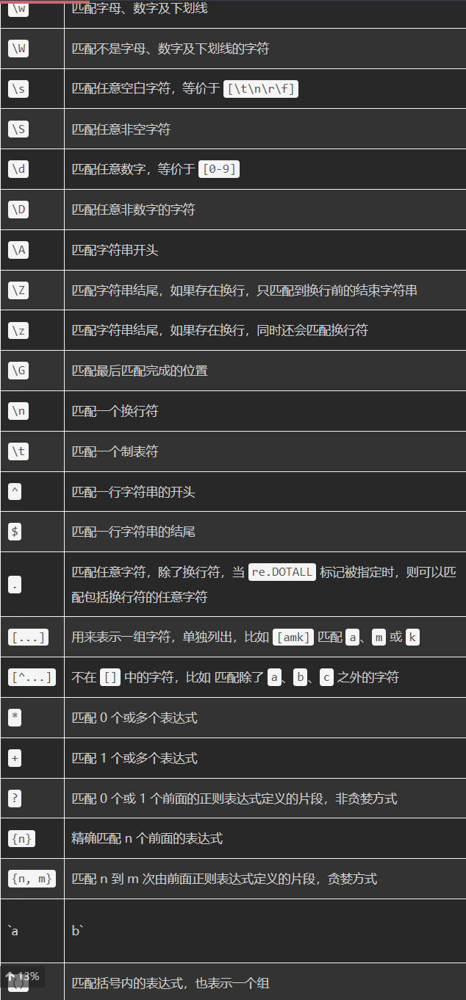

# 正则匹配

常用匹配规则



## 1. `re` 代码框架（覆盖常用用法）

```python
import re

# ── 两种用法：简单一次用 re.xxx()；复用多次先 compile（更快） ──
pat = re.compile(r'(\d{4})-(\d{2})-(\d{2})')

# ── 匹配 ──
pat.match(text)        # 从开头匹配，开头不符→None
pat.search(text)       # 全文找第一个
pat.fullmatch(text)    # 字符串符合？BOOL
pat.findall(text)      # 所有匹配；有分组时返回 [("2026","11","04"), ...]
for m in pat.finditer(text):   # 迭代 Match 对象（要位置/分组时用它）
    m.group(0); m.group(1); m.start(); m.end(); m.span()

# ── 分组 ──
m = re.match(r'(?P<year>\d{4})-(?P<md>\d{2}-\d{2})', '2026-11-04')
m.group('year'); m.groups()          # 命名分组 (?P<名>...)
re.sub(r'(\d+)-(\d+)', r'\2-\1', s)  # 反向引用 \1 或 \g<1>

# ── 替换 / 切分 ──
re.sub(r'\d+', '<num>', text)                       # 替换
re.sub(r'\d+', lambda m: str(int(m.group())*2), t)  # 函数替换（动态处理）
re.subn(r'\s+', ' ', text)                          # 返回 (结果, 替换次数)
re.split(r'[;,，；]\s*', text)                      # 正则切分

# ── 常用 flag ──
re.I   # 忽略大小写
re.M   # 多行模式：^ $ 匹配每行行首行尾
re.S   # 让 . 匹配换行符
re.X   # 允许正则里加空格和注释
re.findall(r'^#.*', text, flags=re.M)

# ── 转义 ──
re.escape('a.b(c){1}')  # 全部特殊字符转义 → 按字面匹配
# 正则字符串永远写 r'...'，防止 \d \b 被 Python 字符串吃掉

# ── 非捕获 / 零宽断言 ──
(?:ab)+      # 非捕获分组（不占用组号）
foo(?=\d)    # 正前瞻：foo 后必须跟数字
foo(?!\d)    # 负前瞻
(?<=\$)\d+   # 正后顾：数字前必须是 $
(?<!\$)\d+   # 负后顾
```

## 2. 正则语法速查

| 类别     | 写法                                         | 含义                                    |
| -------- | -------------------------------------------- | --------------------------------------- |
| 单字符   | `.` `\d` `\w` `\s`（及大写 `\D \W \S` 取反） | 任意字符 / 数字 / 字母数字下划线 / 空白 |
| 字符类   | `[abc]` `[^abc]` `[a-z0-9_]`                 | 自定义集合，取反，区间                  |
| 量词     | `*` `+` `?` `{n}` `{n,}` `{n,m}`             | 0+ / 1+ / 0~1 / 恰好n / ≥n / n~m        |
| 懒惰量词 | `*?` `+?` `??` `{n,m}?`                      | 尽量少匹配（配 `<.*?>` 这类用）         |
| 位置锚   | `^` `$` `\b` `\B` `\A` `\Z`                  | 行首行尾 / 单词边界 / 非边界 / 串首串尾 |
| 分组     | `( )` `(?: )` `(?P<n> )` `|`                 | 捕获 / 非捕获 / 命名 / 或               |
| 反向引用 | `\1` `\g<n>`                                 | 引用前面捕获的内容                      |
| 转义     | `\.` `\*` `\(` `\[` `\{` `\\`                | 让元字符当字面量                        |

## 3. 括号 `{}` `【】` 的种类与匹配

| 类别               | 括号              | 正则里怎么写         | 备注                         |
| ------------------ | ----------------- | -------------------- | ---------------------------- |
| 半角（正则元字符） | `( )` `[ ]` `{ }` | `\(\)` `\[\]` `\{\}` | **必须转义**，否则被当成语法 |
| 全角               | `（） ［］ ｛ ｝` | 直接写               | 非 ASCII，不是元字符         |
| 中文方括号         | `【】 〔〕 〖〗`  | 直接写               | 中文资料常见                 |
| 尖括号             | `< >` `〈 〉`     | `<>` 可直接写        |                              |
| 书名号             | `《》`            | 直接写               |                              |

提取括号内内容的常用写法：

```python
re.findall(r'【([^】]*)】', text)     # 提取 【...】 里的内容
re.findall(r'\{([^{}]*)\}', text)    # 提取 {...} 里的内容
re.findall(r'\(([^()]*)\)', text)    # 提取 (...) 里的内容（单层嵌套）
```

**一句话总结**：半角 `()[]{}` 在正则里是语法符号要转义，全角和中文括号（`（）【】` 等）是普通字符直接匹配；配 `\([^)]*\)` 这类"开括号→非闭括号字符→闭括号"的模板就能取括号内文本。

## 例 1：验证手机号 —— 锚 + 字符类 + 量词

```python
pat = re.compile(r'^1[3-9]\d{9}$')
pat.fullmatch('13812345678')   # True
```

| 片段      | 含义                                   |
| --------- | -------------------------------------- |
| `^` … `$` | 整串就是手机号，不多不少（验证类必备） |
| `1`       | 第一位必须是 1                         |
| `[3-9]`   | 字符类：第二位是 3~9 中任意一个        |
| `\d{9}`   | 恰好 9 位数字                          |

## 例 2：日期格式转换 —— 分组 + 反向引用

```python
re.sub(r'(\d{4})-(\d{2})-(\d{2})', r'\2/\3/\1', '今天是2026-11-04')
# → '今天是11/04/2026'
```

`()` 把年月日分别捕获成第 1、2、3 组，替换串里 `\2/\3/\1` 就是"第2组/第3组/第1组"。**替换串里的 `\1` 提醒：整个正则和替换串都要用 `r''`**。

## 例 3：提取【】内容 —— 贪婪 vs 懒惰（最重要的坑）

```python
s = '重点【正则】和【分组】要掌握'
re.findall(r'【(.*?)】', s)   # ['正则', '分组']   ← 懒惰：匹配到最近的】就停
re.findall(r'【(.*)】', s)    # ['正则】和【分组'] ← 贪婪：一口气吞到最后一个】
```

`*` 默认"越多越好"（贪婪），加 `?` 变"越少越好"（懒惰）。**凡是要配对的括号内容，一律用 `.*?`**。

## 例 4：验证邮箱 —— 组合运用

```python
mail = re.compile(r'^[\w.-]+@[\w-]+(\.[\w-]+)+$')
mail.fullmatch('a.b_c@mail.example.com')   # True
```

| 片段          | 含义                                                         |
| ------------- | ------------------------------------------------------------ |
| `[\w.-]+`     | 用户名：字母数字下划线，允许 `.` 和 `-`                      |
| `@`           | 字面 @                                                       |
| `(\.[\w-]+)+` | `.域名` 至少出现一次（`\.` 转义点号）：同时兼容 `a@b.com` 和 `a@mail.example.com` |

## 例 5：解析日志 —— 命名分组（结构化提取）

```python
line = '2026-11-04 12:00:01 ERROR user=wangq ip=10.0.0.8'
m = re.search(r'(?P<date>\d{4}-\d{2}-\d{2}) (?P<time>[\d:]+) (?P<level>\w+) user=(?P<user>\w+)', line)
m.groupdict()
# {'date': '2026-11-04', 'time': '12:00:01', 'level': 'ERROR', 'user': 'wangq'}
```

`(?P<名字>…)` 给组起名字，直接 `groupdict()` 得到字典，比数 `\1\2\3` 清晰得多。注意**组与组之间用普通空格连接就是匹配空格**。

## 例 6：只替换"价格"后面的数字 —— 后顾

```python
re.sub(r'(?<=价格)\d+', r'<\g<0>>', '价格100元, 数量50个')
# → '价格<100>元, 数量50个'
```

`(?<=价格)` 是"零宽后顾"：要求数字**前面是"价格"**，但"价格"两个字本身不参与替换。对比：不加后顾会把 50 也改掉。`\g<0>` 指"整个匹配到的串"。

## 例 7：手机号脱敏 —— 分组保留 + 遮蔽

```python
re.sub(r'(1[3-9]\d)\d{4}(\d{4})', r'\1****\2', '请联系13812345678')
# → '请联系138****5678'
```

三段式：`(前3位) 中间4位 (后4位)`，中间用 `****` 换掉，前后用 `\1 \2` 原样放回。所有"保留部分+替换部分"的脱敏、改写都用这个套路。

## 例 8：两个常用 flag

```python
re.findall(r'^#.*', '# 标题\n正文\n# 小结', flags=re.M)   # ['# 标题', '# 小结']
# re.M：^ $ 从"整串首尾"变成"每行首尾"

re.findall(r'<p>.*?</p>', '<p>第一段\n第二段</p>', flags=re.S)  # 匹配成功
# re.S：让 . 能匹配换行符（默认 . 遇到 \n 就停）
```

---

## 读正则的三步法

1. **先找锚**：`^ $ \b (?<=)` —— 确定匹配发生在什么位置；
2. **再分段**：按"固定字符 + 变化部分"切成几段，变化部分用 `\d \w [...] {n}` 描述；
3. **最后判贪婪**：凡是要"最短匹配/配对截取"，检查每个 `*` `+` 是否该加 `?`。

## 新手最常踩的 4 个坑

| 坑            | 现象                                            | 解法                                      |
| ------------- | ----------------------------------------------- | ----------------------------------------- |
| 忘加 `r''`    | `\b`、`\g<0>` 被 Python 字符串转义报警          | 正则和替换串**永远写 `r'...'`**           |
| 贪婪失控      | `【(.*)】` 吞掉中间所有内容                     | 配对内容用 `.*?`                          |
| 不转义点号    | `a.b` 把 `.` 当"任意字符"                       | 字面量用 `\.`，整串不确定就 `re.escape()` |
| 验证不用 `^$` | `re.match` 只查开头，`'abc手机号123'` 也判 True | 验证用 `fullmatch()` 或 `^...$`           |

练手建议：把例 2 改成"提取身份证里的出生日期"、把例 5 改成解析你自己的 nginx/某游戏日志、把例 7 改成给邮箱脱敏——改三个例子比看十页教程管用。

