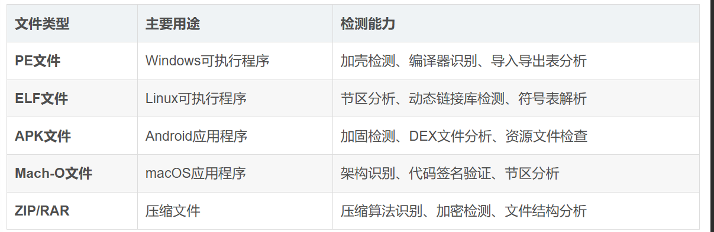

# DIE的使用

Detect It Easy是一款功能强大且易于使用的文件分析工具


支持文件格式



> ## 双重检测机制：
>
> 1. **签名检测**：基于预定义的签名数据库快速识别已知文件格式
> 2. **启发式分析**：通过算法分析文件特征，识别未知或变种文件


# 分析壳

```dart
MSDOS
    Operation system: MS-DOS [8086, 16位, EXE]
PE64
    Operation system: Windows (Server 2003) [AMD64, 64位, 控制台]
    Compiler: MinGW
    Language: C/C++
    (Heur) Protection: Generic [Section #0 ("LMAO") has RWX + IAT directory empty]
    Packer: UPX (3.91+) [modified]
        
    (Heur) Packer: Generic [EntryPoint + Structure and IAT like UPX + Imports like UPX (v3.91+) + Section #1 ("Yuli") compressed + Section #0 ("LMAO") has wrong size + Section #0 ("LMAO") and #1 ("Yuli") have one offset + Strange overlay + High entropy]
        
    Overlay: Binary [偏移 = 0x8e00, 大小 = 0x9287]
        未知: 未知

```


[终极Detect It Easy使用指南：从安装到高级文件分析的完整教程-CSDN博客](https://blog.csdn.net/gitblog_00190/article/details/160753659)