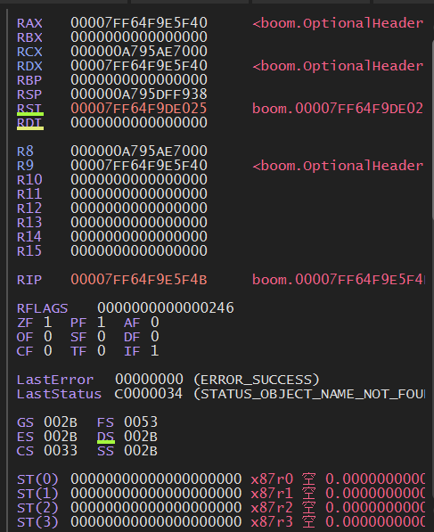
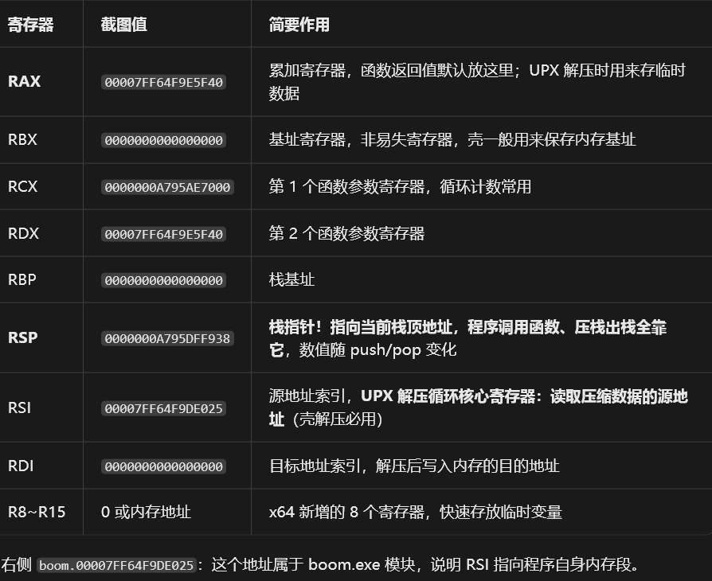

# 寄存器（All Register)



## 一，通用 64 位寄存器



## 二，RIP 指令指针

```
RIP  00007FF64F9E5F4B   boom.00007FF64F9E5F4B
```

✅ **RIP = Instruction Pointer**：保存**下一条要执行指令的内存地址**

> RIP 就是 x86-64 架构下的程序计数器 PC，是同一个东西在不同 CPU 架构里的名字

> **RIP（Instruction Pointer，指令指针寄存器）**：，就是 x64 架构实现的 PC。
> x86-64（AMD64）CPU 的硬件寄存器名
> 在 32 位 x86（IA-32）里面，它叫 EIP。
> 在 16 位 8086 里叫 IP。

## 三、RFLAGS 标志寄存器（RFL）

RFLAGS 里面每一个 bit，记录上一条指令运算结果状态：

- **ZF Zero Flag 零标志**：运算结果为 0 则置 1。`jz` / `jnz` 跳转完全靠 ZF 判断，逆向、壳代码里用得极多。
- **CF Carry Flag 进位标志**：无符号数溢出 / 产生进位。
- **OF Overflow Flag 溢出标志**：有符号数溢出。
- **SF Sign Flag 符号标志**：结果最高位是 1（负数）置 1。
- **PF Parity Flag 奇偶标志**：结果低 8 位中 1 的个数是偶数则置 1。
- **DF Direction Flag 方向标志**：控制 `rep movsb` / `rep lodsb` 串操作时 RSI/RDI 增减方向。UPX 解压大量使用串指令，DF 非常关键！
- **IF Interrupt Enable Flag 中断允许位**：IF=1，允许硬件中断；IF=0 屏蔽中断。
- **TF：单步陷阱标志**，调试器（x64dbg）就是靠 TF 实现单步调试。
- **AF = Auxiliary Flag**，辅助进位标志（半进位标志）


> RFLAGS 就是 x86‑64 的程序状态寄存器（PSR / Program Status Register），对应 ARM 的 CPSR / SPSR。
>
> 就是程序状态数

## 四、LastError / LastStatus

```
LastError     00000000 (ERROR_SUCCESS)
LastStatus    C0000034 (STATUS_OBJECT_NAME_NOT_FOUND)
```

- `LastError=0`：最近一次 Win32 API 调用成功
- `LastStatus=C0000034`：**更早一次 NT 内核调用找不到对象，属于残留状态，不影响当前 boom 壳代码执行**。

LastError（Windows Win32 API 错误码）：成功的 API 不会重置 LastError，所以看到非 0 值，**不代表刚出错**，可能是之前旧调用残留。

LastStatus（NTSTATUS，内核层返回码）：

## 五，段寄存器 GS FS ES CS DS SS

```
GS 002B FS 0053
ES 002B DS 002B
CS 0033 SS 002B
```

- CS（Code Segment，代码段）=0033：代表当前执行的是 64 位代码（64 位程序 CS 固定 0x33）。
- FS：Windows 64 位用 FS 寄存器指向 TEB 线程环境块，存线程信息。
- SS：栈段；DS/ES/GS：数据段，64 位模式下基本不再用来做内存分段，保留用于系统

## 六、ST (0)~ST (3) FPU 浮点寄存器

FPU 是浮点运算单元，ST0~ST7 是 80 位浮点栈寄存器