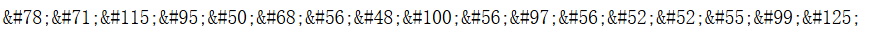

# 常见编码方式（ENC0D3)

## #1二进制转ASCII

原理：ASCII 一个字符 = 8 bit（8 位二进制），所以要每 8 个 bit 切成一组，每组转成十进制，再转 chr () 字符。**

```python
str1 = "nine Bird nine nine nine Bird Bird nine nine Bird Bird nine Bird Bird nine nine nine Bird Bird nine nine nine nine Bird nine Bird Bird nine nine Bird Bird Bird nine nine Bird Bird nine nine Bird nine nine nine Bird Bird Bird nine Bird nine nine nine Bird nine nine nine nine nine nine Bird nine Bird Bird Bird Bird Bird nine Bird nine Bird nine nine Bird Bird nine Bird Bird nine Bird Bird Bird Bird nine Bird nine Bird Bird Bird Bird Bird nine Bird nine nine nine Bird Bird Bird nine Bird Bird nine Bird Bird Bird Bird nine nine Bird Bird nine nine nine nine nine Bird Bird nine nine Bird nine nine nine Bird Bird nine nine Bird nine nine nine Bird Bird nine nine Bird nine nine nine Bird Bird nine nine Bird nine nine"
str1 = str1.replace("nine" , "0")
str1 = str1.replace("Bird" , "1")
str1 = str1.replace(" ", "")
num1 = int(str1 , 2)
result = ""
for i in range(0, len(str1), 8):
    chunk = str1[i:i+8]
    # 二进制转十进制，再转ascii字符
    ascii_num = int(chunk, 2)
    result += chr(ascii_num)
print(result)
```

flag{7h15_15_4_fl46_w17h_m4ny_l4ngu4g35_fr0m_4r0und_7h3_w0rld}

## 		URL编码：

Base64

