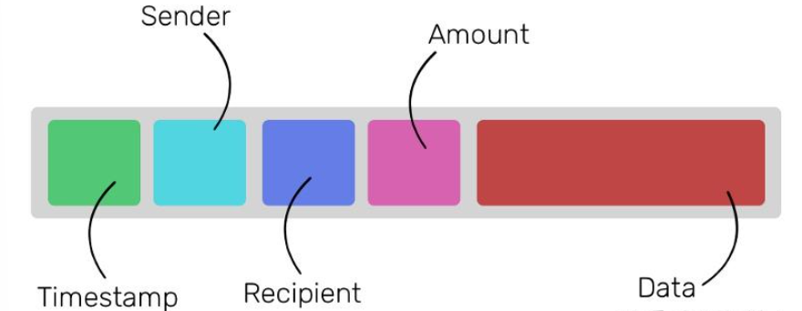

# 区块链block chain

## 0，前置

## 	**i,区块链**

**简言之，区块链就是数据库。**它是特定数据的数据库，里面的数据不断增长，具有非凡特性：

1. 一旦数据存储于数据库，永远都无法被修改或删除。区块链上的每个记录会被永久保存下来。
2. 没有单独的个人或组织能维护该数据库。必须要上千个人才行，每个人都有数据库的副本。

想象一下有一个包含10个人的网络。每个人都有一个空的文件夹和一个空白页。无论这个网络中的何人在何时做了什么重要的事，如转账等，会广播给该网络中的所有人。每个人都会在自己的页面上记录公告，直到该页面填满为止。**页面填满之时，每个人必须通过解决一个数学难题来将页面内容封存。如此可以确保每个人的页面具有相同内容，且这些内容永远无法修改。第一个解决这一数学难题的人会得到一些加密货币的奖励。**

随着时间的推移，这些包含重要记录（交易）的页面（区块）就会逐一加入文件夹（链），因而形成数据库（区块链）。

## 	**ii.区块链存储什么**

**区块链可用于存储任何类型的数据**，存储在区块链上的数据类型会赋予区块链价值。（**比特币的区块链**存储的是金融交易记录）

以太坊不只是一种类似美元、英镑或比特币的货币。以太坊有一个比货币更强的用处。以太坊从根本上来说是一个巨大的计算机！但是，它运行起来极其缓慢——比如今的普通计算机的运行速度缓慢约5至100倍——而且成本很高。**它是一个分布于全世界的完全去中心化计算机。**

## 	iii，区块链如何运作

**与其它区块链一样，以太坊**需要几千人在自己的计算机上运行一个软件，为该网络提供动力。网络中的每个节点（计算机）运行一个叫做以太坊虚拟机（EVM）的软件。将以太坊虚拟机想象成一个操作系统，它能理解并执行通过以太坊特定编程语言编写的软件。**由以太坊虚拟机执行的软件/应用程序被称为“智能合约”。**

要在这一世界计算机上做任何事都需付费。

## 	IV,智能合约的力量

智能合约一旦完成，无论如何都无法被编辑或修改。因此，可以肯定的是不管合约中有何规定，无论如何都会被执行。

> 现在我们有三种不同的打赌方法，不过各有都缺陷。因为我们是陌生人，无法互相信任。迫使对方履行法定合同的成本太高，此举并不可行。寻求共同朋友的帮助又会引发信任问题。
>
> 以太坊的智能合约在这种情况下就可以派上用场了。智能合约就像是寻求共同朋友的帮助，不过是被编写成了代码。通过以太坊，我们可以编写一款软件，向两方各收取价值100美元的以太币。第二天打开接入天气应用的API查看天气情况，并将总价值为200美元的以太币转给赢家。

**正是区块链数据存储后的不可修改性使得其存储的数据--“智能合约”具有强制执行力，为一些交易提供了信用保障**

## 	V智能合约与区块链

**不管智能合约于何时执行**,它都记录了在区块上执行的交易的信息。从很高的层面上看来，以太坊区块链上的交易如下：

  所有的交易类型可以分为三类

1，人类用户和用户之间的常见以太币转账		数据项留空

2，无接收方的以太币转账			

在进行没有接收方的交易时，这就意味着该交易的目的是在网络中利用“数据”项的内容创建一个智能合约。“数据”项中包含软件代码，该代码会像网络中的其它用户一样进行操作。

3.用户和智能合约之间的以太币转账

无论用户（或智能合约）何时想要执行智能合约，他/她/它需要与智能合约进行一次交易，将执行指令置于“数据”项中。

## 	VI，gas

**我说过**使用智能合约的**用户**必须支付一定费用去执行该合约。该费用支付给实际使用内存、硬盘、计算和电力执行这一智能合约的节点。

为了[计算智能](https://zhida.zhihu.com/search?content_id=174993652&content_type=Article&match_order=1&q=计算智能&zhida_source=entity)合约的费用，每个语句都有指定的成本。例如，如果你的是执行使用[节点内存](https://zhida.zhihu.com/search?content_id=174993652&content_type=Article&match_order=1&q=节点内存&zhida_source=entity)的语句，这类语句有特定成本。如果你执行的是使用节点[硬盘存储器](https://zhida.zhihu.com/search?content_id=174993652&content_type=Article&match_order=1&q=硬盘存储器&zhida_source=entity)的语句，这类语句有附加的特定成本。特定成本的单位被称作[Gas](https://zhida.zhihu.com/search?content_id=174993652&content_type=Article&match_order=1&q=Gas&zhida_source=entity)。最终，Gas通过一定的兑换率转换成以太币。

无论你何时执行智能合约，你必须确定要消耗的最大Gas量。当合约执行完成之时，或是达到Gas限制之时，都会停止执行该合约。这么做是为了避免智能合约陷入无限循环之中，以防该程序反复执行一组语句，而不继续执行其他合约。

之所以会出现该情况是因为程序员的疏忽。每重复一次都会消耗一些特定的Gas，因此会将无限循环变为有限。因为程序员的失误让节点陷入反复执行之中是毫无意义的。Gas的概念解决了这一问题。

