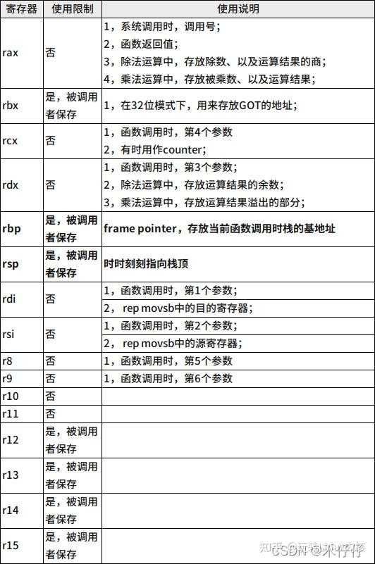

### AT&T风格

[(2 封私信 / 40 条消息) x86汇编语言基础(AT&T语法) - 知乎](https://zhuanlan.zhihu.com/p/627238135)

### #1通用寄存器



### 寄存器的位数

在王爽的《汇编语言》见过ax、ah/al寄存器，这时16bit和高低8bit的寄存器，在目前的x86-64架构中会见到eax、和rax，分别对应32bit，64bit寄存器。

方便记忆：

```reStructuredText
a:accumulator 累加
h/l:high/low 高低
e:extend 扩展
r:register 寄存器？找个猜的不对
```

### #2指令说明

**1、前缀**
AT&T 汇编中：

- 寄存器前被冠以“%”
- 立即数前被冠以“$”
- 十六进制数前被冠以“0x”

**2、后缀**

操作码的后缀一般表示操作码的位数，l代表32位，w代表16位，b代表8位。

例如汇编中常见的

movl就是操作32位寄存器，movb是8bit。

**3、操作数方向**

操作数的方向和intel有点不一样，比如把立即数$0x13放到寄存器%ah中，用的是movb $0x42,%ah，即源操作数在前，目的操作数在后，这一点和intel汇编语法正好相反。

对于内存单元操作数来说，在AT&T 中是把寄存器用（）括起来，而非[]。

举例说明

```asm
movl 0x13, %ebx
movl %ebx, 8(%si)
```

## #3常用指令

**1、运算指令**
常见的指令如下：

```asm
addl %edx, %eax   //edx+eax，结果放到eax l表示32位，后面指令位64位
add  $5,%r10 	  // 5 + r10，结果放到r10
div  %r10 		  //rax 除以r10，商放到rax，余数放到rdx
inc  %r10 		  // r10 加1
mul  %r10 		  // 将rax乘以 r10, 将结果放到rax中，溢出部分放到rdx
```

**2、拷贝指令**

拷贝有从寄存器到寄存器、从寄存器到内存

```asm
mov %r10,%r11 	//将r10寄存器的值赋值给r11 ；
mov $99,%r10 	//将立即数99赋值给r10寄存器；
mov %r10,(%r11) // 将r10的值拷贝到r11寄存器中的数值指向的内存地址上；
mov (%r10),%r11 // 将r10中数值指向的内存地址上的内容拷贝到r11；
push %r10 		// 将r10的值放到栈上 ；
pop %r10 		// 将栈顶的值pop到r10寄存器上。
```

**3、流程控制指令**

任何一种高级语言都有流程控制的关键词，同样对应汇编也有。这里主要介绍汇编的**跳转指令和标签**，我们这里看一段汇编代码：

```asm
cmpb $GRUB_INVALID_DRIVE,%al
    je 1f
    movb %al,%dl
1:
    pushw %dx
```

首先这里就用到了标签，和跳转指令。其中：

1就是标签label

comb，表示8bit的的比较操作，cmpb $GRUB_INVALID_DRIVE,%al表示，比较立即数GRUB_INVALID_DRIVE和al（ax低8bit）存储的数字

je 1f是跳转指令。j:jump e:equal 表示前面两数比较，如果相等，就跳转到label1的位置。

1f 1是标签，f:forward这里表示向前寻找标签1，如果是b:backward表示向后寻找。当有重复存在时使用，一般自动编译不会重复，自己写汇编可以这么用。

**下面列举几个常见的跳转指令：**

```asm
cmp %r10,%r11 // 比较r10 和 r11，根据比较结果来设置CPU的状态寄存器，从而影响后面的jump语句；
cmp $99,%r11  // 比较99和r11，根据比较结果来设置CPU的状态寄存器，从而影响后面的jump语句；
jmp label 	  //跳转到label
je label 	  //如果相等，跳转到label
jne label 	  // 如果不相等，跳转到label
jl label 	  // 如果小于，跳转到label
jg label 	  // 如果大于，跳转到label
call label	  // 调用函数
ret 		  // 从函数调用返回
syscall 	  //系统调用 (32位模式下, 使用"int $0x80" 软中断)
```

1，.byte 表达式（expression_rs）

.byte可不带参数或者带多个表达式参数，表达式之间由逗点分隔。每个表达式参数都被汇编成下一个字节。在stage1.s中，有这么一段代码：