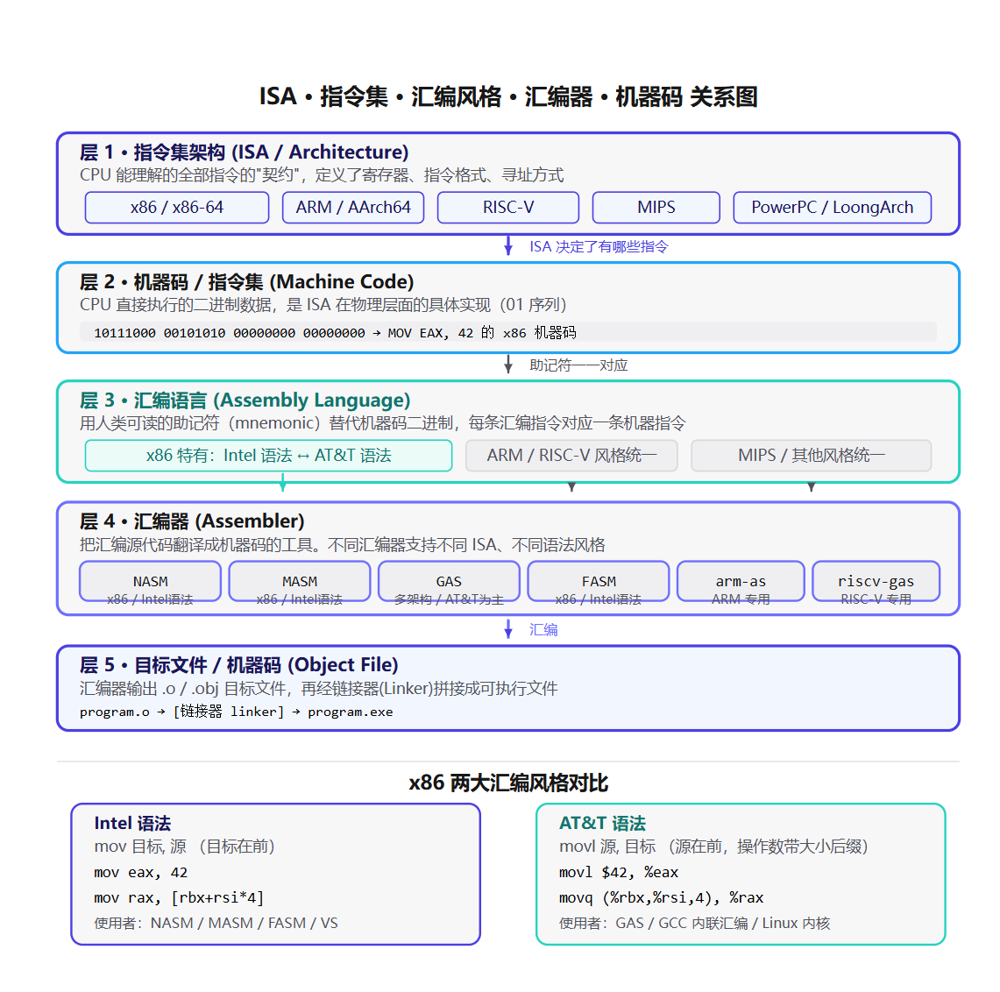
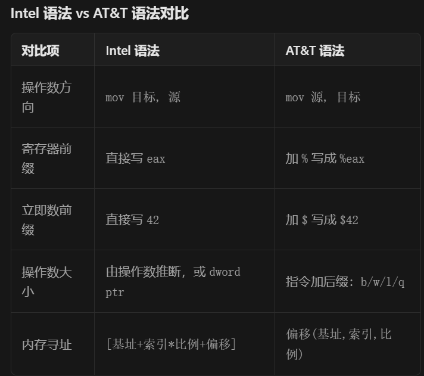
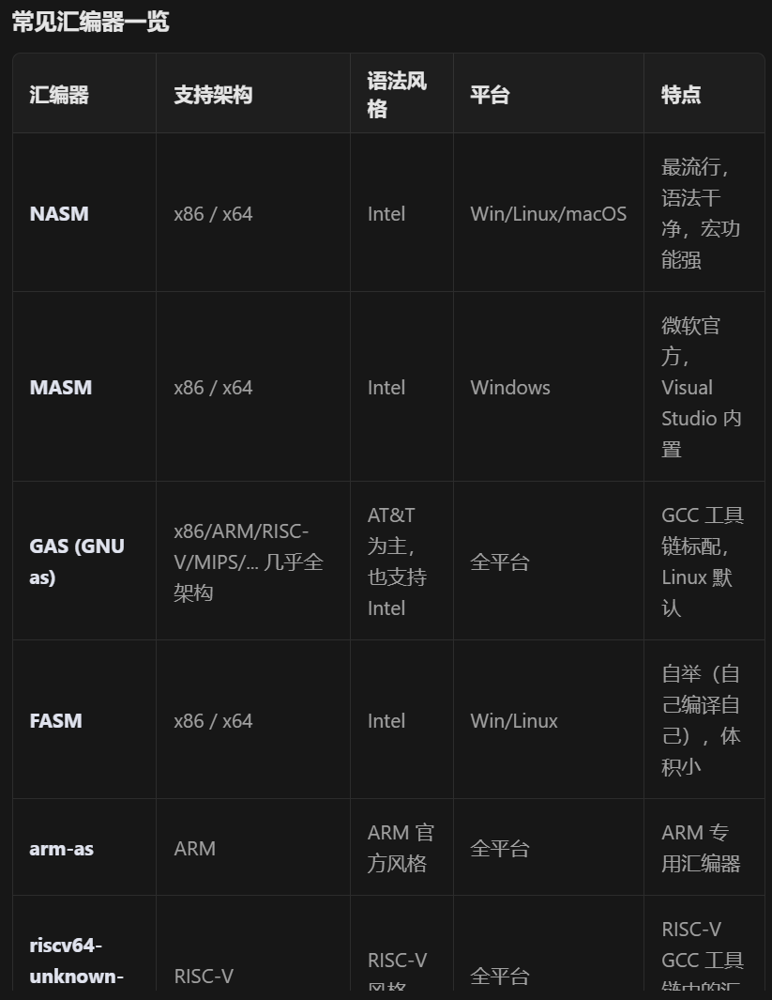

# 汇编语言

## 1，gcc的使用

```bash
PS C:\Path> gcc file_name.c -code  #注意 -为及物动词 --为不及物动词
PS C:\Path> gcc --code        
#常见指令
	#保留中间文件（intermidia
PS C:\Path> gcc -E file_name.c -o file_name.c
#Preprocess only; do not compile, assemble or link.
PS C:\Path> gcc file_name.c -c 			
#Compile and assemble, but do not link.
PS C:\Path> gcc file_name.c -S
#Compile only; do not assemble or link.
PS C:\Path> gcc file_name.c -save-temps
#Do not delete intermediate files.
	#常规操作
PS C:\Path> gcc file_name.c -o<file>
#Place the output into <file>.


```


```bash
PS C:\Cfiles> gcc --help   
Usage: gcc.exe [options] file...
Options:
  -pass-exit-codes         Exit with highest error code from a phase.
  --help                   Display this information.
  --target-help            Display target specific command line options (including assembler and linker options).
  --help={common|optimizers|params|target|warnings|[^]{joined|separate|undocumented}}[,...].
                           Display specific types of command line options.
  (Use '-v --help' to display command line options of sub-processes).
  --version                Display compiler version information.
  -dumpspecs               Display all of the built in spec strings.
  -dumpversion             Display the version of the compiler.
  -dumpmachine             Display the compiler's target processor.
  -foffload=<targets>      Specify offloading targets.
  -print-search-dirs       Display the directories in the compiler's search path.
  -print-libgcc-file-name  Display the name of the compiler's companion library.
  -print-file-name=<lib>   Display the full path to library <lib>.
  -print-prog-name=<prog>  Display the full path to compiler component <prog>.
  -print-multiarch         Display the target's normalized GNU triplet, used as
                           a component in the library path.
  -print-multi-directory   Display the root directory for versions of libgcc.
  -print-multi-lib         Display the mapping between command line options and
                           multiple library search directories.
  -print-multi-os-directory Display the relative path to OS libraries.
  -print-sysroot           Display the target libraries directory.
  -print-sysroot-headers-suffix Display the sysroot suffix used to find headers.
  -Wa,<options>            Pass comma-separated <options> on to the assembler.
  -Wp,<options>            Pass comma-separated <options> on to the preprocessor.
  -Wl,<options>            Pass comma-separated <options> on to the linker.
  -Xassembler <arg>        Pass <arg> on to the assembler.
  -Xpreprocessor <arg>     Pass <arg> on to the preprocessor.
  -Xlinker <arg>           Pass <arg> on to the linker.
  -save-temps              Do not delete intermediate files.
  -save-temps=<arg>        Do not delete intermediate files.
  -no-canonical-prefixes   Do not canonicalize paths when building relative
                           prefixes to other gcc components.
  -pipe                    Use pipes rather than intermediate files.
  -time                    Time the execution of each subprocess.
  -specs=<file>            Override built-in specs with the contents of <file>.
  -std=<standard>          Assume that the input sources are for <standard>.
  --sysroot=<directory>    Use <directory> as the root directory for headers
                           and libraries.
  -B <directory>           Add <directory> to the compiler's search paths.
  -v                       Display the programs invoked by the compiler.
  -###                     Like -v but options quoted and commands not executed.
  -E                       Preprocess only; do not compile, assemble or link.
  -S                       Compile only; do not assemble or link.
  -c                       Compile and assemble, but do not link.
  -o <file>                Place the output into <file>.
  -pie                     Create a dynamically linked position independent
                           executable.
  -shared                  Create a shared library.
  -x <language>            Specify the language of the following input files.
                           Permissible languages include: c c++ assembler none
                           'none' means revert to the default behavior of
                           guessing the language based on the file's extension.

Options starting with -g, -f, -m, -O, -W, or --param are automatically
 passed on to the various sub-processes invoked by gcc.exe.  In order to pass
 other options on to these processes the -W<letter> options must be used.

For bug reporting instructions, please see:
<https://github.com/msys2/MINGW-packages/issues>.
```

## 2，.C文件的编译过程

## 	#1预处理（preprocess）		.i 文本文件 gcc ....-E

- 展开 `#include`，把头文件内容全部粘贴进来

- 替换 `#define` 宏(define做的是***查找--替换*** ， 比较危险)

- 删除注释

- 处理条件编译 `#ifdef` / `#endif`

- 输出：`.i` 文本文件，还是 C 语法

## #2编译（compile,C-->汇编）	.s汇编文本 gcc ...-S

  - **词法分析、语法分析、语义检查** 
  - 生成抽象语法树 AST（抽象语法树abstracted syntax tree），做优化

抽象语法树的列表怕就是抽象语法地图（ASM)l了

```latex
赋值表达式
├─ 左值：变量 a
└─ 右值：加法表达式
   ├─ 操作数：常量1
   └─ 操作数：常量2
```

  - 翻译成汇编指令

```
#【行号】 【汇编指令】 【可选注释】
	.file	"2binary.c"
	.text
	.section .rdata,"dr"
.LC0:
	.ascii "Hello World\0"
	.text
	.globl	main
	.def	main;	.scl	2;	.type	32;	.endef
	.seh_proc	main
main:
	pushq	%rbp
	.seh_pushreg	%rbp
	movq	%rsp, %rbp
```


## #3汇编（assemble，汇编-->机器码） 

## 															.o目标文件 gcc...-c

- 将汇编指令逐条翻译成 CPU 可识别的二进制机器码

- 生成**目标文件 .o**

  > `.o` 结构：机器指令段 (.text)、全局数据 (.data)、符号表、重定位表。
  >
  > (文件已经是二进制的了,IDE下将会看到乱码)
  > 
  > (此时还不能运行，因为调用外部函数（比如`printf`）地址是空的)

## #4链接（link, 目标文件 -- > 可执行文件)  .exe文件

- 合并多个 `.o` 的段（代码段、数据段）
- 符号解析：找到未定义符号（如 printf）
- 重定位：修正函数调用地址，把空白处填上真实地址
- 链接系统库（libc）


## #5ummary:

## .c ---1预处理(-E）--- .i  (文本文件)	

## .c---2编译（-S) --- .s (汇编文件)

## .c---3汇编（-c)---.o(二进制目标文件)

## .c---4链接 (gcc)---.exe(二进制可执行文件)


# 3汇编语言初步

## #1硬件到软件




CPU 架构决定指令集；指令集定义机器码；

汇编风格是指令的语法；汇编器是把这种文本翻译成机器码的翻译程序。

汇编器在汇编阶段根据目标架构参数（内部已经有这种语法实现的情况下）使用对应的指令集架构将汇编语言翻译成对应CPU架构下的CPU可直接执行的机器码

### 指令集架构ISA

ISA = Instruction Set Architecture ，是 CPU 和软件之间的"契约"——它定义了：

- 有哪些寄存器、多少个、多宽
- 有哪些指令（加、减、跳转、读写内存…）
- 指令的二进制编码格式
- 寻址方式（怎么找到内存里的数据）
ISA 和架构的关系 ：严格来说 ISA 是抽象规范，微架构（Microarchitecture）是具体实现。但日常说话中"x86 架构"、"ARM 架构"指的就是 ISA。

| 主流 ISA         | 特点                                                     | 代表CPU                    |
| ---------------- | -------------------------------------------------------- | -------------------------- |
| **x86 / x86-64** | **CISC（复杂指令集），指令长度不固定，功能强但解码复杂** | **Intel i7/i9、AMD Ryzen** |
| ARM / AArch64    | RISC（精简指令集），定长指令，低功耗                     | 手机、Mac M 系列、树莓派   |
| RISC-V           | 开源免费的 RISC，模块化设计，可扩展自定义指令            | 平头哥、SiFive、各种国产芯 |
| MIPS             | 经典 RISC，教学常用，商业式微                            | 龙芯早期、部分路由器       |
| LoongArch        | 龙芯自研，兼容 MIPS 思路但全新指令集                     | 龙芯 3A5000/6000           |

> CISC vs RISC ：CISC 一条指令能干很多事（比如`pushad` 一次压入 8 个寄存器），指令长短不一；RISC 一条指令只做一件事，全部等长，更利于流水线优化。现在两者边界在模糊（x86 内部也会把 CISC 指令拆成 RISC 风格的 μop 执行）。

### 机器码（Machine Code）

一条机器指令的构成 （以典型 RISC 为例）：

- 操作码（opcode） ：这是啥指令？加？减？跳转？
- 操作数（operand） ：对谁操作？寄存器编号？立即数？内存地址？

```plain text
RISC-V 加法指令编码示意：
┌────────┬─────┬─────┬─────┬──────┬─────────┐
│ funct7 │ rs2 │ rs1 │funct3│ rd  │ opcode  │
│ 7 位   │ 5位 │ 5位 │ 3位  │ 5位 │ 7位     │
└────────┴─────┴─────┴─────┴──────┴─────────┘
 共 32 位 = 4 字节
```

### 汇编语言（Assembly Language）

只有 x86 世界有"两种语法风格"之争 ，ARM、RISC-V、MIPS 等各自只有一种主流写法。



```asm
; Intel 风格（NASM / MASM）
mov eax, 42
mov rax, [rbx + rsi*4 + 16]
mov byte [mem], 0xFF

# AT&T 风格（GAS / GCC 内联汇编）
movl $42, %eax
movq 16(%rbx,%rsi,4), %rax
movb $0xFF, mem
```

### 汇编器（Assembler）

汇编器是 把汇编源代码翻译成机器码的软件工具 。它是"翻译官"，输入是`.asm` /`.s` 文件，输出是`.o` /`.obj` 目标文件。



汇编器还做了什么？

不只是"逐行翻译"，汇编器还处理：

- 符号解析 ：标签`loop_start:` 翻译成地址
- 伪指令（pseudo-instruction） ：比如 ARM 里`mov r0, #1000` 实际上汇编器会把它拆成两条真实指令
- 宏展开 ：`%macro` 之类的预处理
- 段管理 ：`.text` （代码段）、`.data` （数据段）、`.bss` （未初始化数据段）
- 重定位信息 ：生成`.o` 文件里标注哪些地址需要链接器修改

### 目标文件 → 可执行文件（链接器）

```
foo.asm ──[汇编器]──→ foo.o ──┐
bar.asm ──[汇编器]──→ bar.o ──┼──[链接器 Linker]──→ program.exe
libc.lib  (库文件)  ───────────┘
```

链接器负责：

- 把多个`.o` 文件拼接在一起
- 解析跨文件的函数调用（foo.o 调用 bar.o 的函数）
- 合并段（所有`.text` 放一起，所有`.data` 放一起）
- 分配最终的内存地址